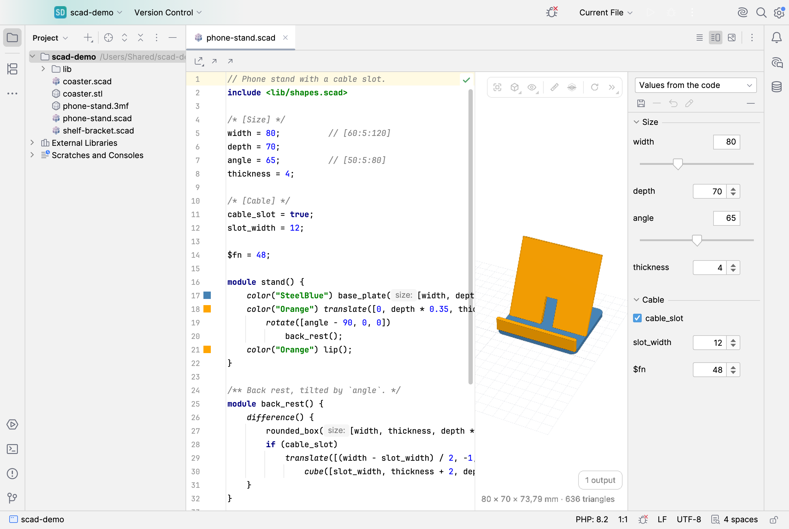

# SCAD Sphere


Plugin ID `app.heckit.ide.scadsphere` · Vendor heck\it ([heckit.app](https://heckit.app)) · [JetBrains Marketplace](https://plugins.jetbrains.com/plugin/35691-scad-sphere) · Source: https://github.com/phse/scad-sphere · Support: [GitHub Sponsors](https://github.com/sponsors/phse) or [Ko-fi](https://ko-fi.com/phse_de) · Feedback and feature requests: [plugin-scad-sphere@heckit.app](mailto:plugin-scad-sphere@heckit.app)



A plugin for JetBrains IDEs (PhpStorm, IntelliJ IDEA, … 2026.1 and later) for [OpenSCAD](https://openscad.org):
language support for `.scad` files, a live 3D preview rendered with the installed OpenSCAD with a Customizer for the
parameters, export to all formats OpenSCAD writes, a viewer and converter for `.stl`, `.3mf`, `.obj`, `.off` and
`.amf` files, and MCP tools that let an AI assistant render a model and look at the result.

The language support only ever searches OpenSCAD files. Find Usages in PHP, HTML or any other language is not
slowed down by it: the plugin registers no global search extensions, its references reject non-OpenSCAD targets
before resolving anything, and the use scope of every declaration is limited to `.scad` files (or to the block,
loop or `let` it lives in).

**Editing**

- Highlighting: keywords, numbers, strings, `include`/`use` paths, comments, plus declarations, module and
  function calls (own and built-in), parameters, named arguments, special variables (`$fn`, `$fa`, …) and
  modifiers (`# ! % *`). Colors in *Settings | Editor | Color Scheme | OpenSCAD*.
- **Go to declaration**, **Find Usages**, **Rename** (in place) and highlighting of usages for modules,
  functions, variables and parameters. Named arguments (`cube(size = 3)`) point to the parameter, so renaming a
  parameter renames them too. Scopes follow OpenSCAD: blocks, module and function parameters, `for`/`let`
  variables (also in list comprehensions), the file, then `include` (everything, transitive) and `use` (modules
  and functions only).
- `include <…>`/`use <…>` paths are links (⌘-click), complete like file paths and follow file renames.
  They are looked up next to the file, in the folders from *Settings | Tools | SCAD Sphere*, in `OPENSCADPATH`,
  in the user library folder (`~/Documents/OpenSCAD/libraries` on macOS) and in the libraries of the installation.
- **Install a library**: a missing `include`/`use` of a known library (BOSL2, BOSL, NopSCADlib, MCAD, Round-Anything,
  threads-scad, smooth-prim, scad-utils, YAPP_Box) offers the quick fix *Download library … from GitHub*. After a
  confirmation naming the repository, the license and the target, the ZIP of the main branch is unpacked into the user
  library folder (no git needed); an existing folder is never overwritten.
- **Go to Symbol** (⌘⌥O / Ctrl+Alt+Shift+N) finds modules and functions in all `.scad` files of the project (own file-based
  index of the top-level declarations). Library folders outside the project appear under *External Libraries* and are
  found with *Include non-project items*.
- **Colors**: a swatch in the gutter next to `color()` with a literal (`"red"`, `"#ff0000"`, `[1, 0, 0]`, with alpha);
  a click opens the color picker and writes the color back in the same notation (names become hex).
- **Parameter name hints** before literal arguments of calls with at least two arguments: `cube([1, 2, 3], center: true)`.
  Toggle in *Settings | Editor | Inlay Hints | Parameter names*.
- **Live templates** (*Settings | Editor | Live Templates | OpenSCAD*): `mod`, `fun`, `for`, `diff` (with the cut part
  marked `#`), `uni`, `inter`, `hull`, `tr`, `rot`, `col`, `cust` (Customizer group with slider), `hid` (`[Hidden]` with `$fn`).
- **Completion** of modules, functions, variables, the built-ins and, inside a call, the parameter names of the
  called module or function (`name = `). **Parameter info** (⌘P / Ctrl+P).
- **Documentation** (F1 / Ctrl+Q, also on hover): built-in modules and functions with signature, description
  and a link to the OpenSCAD manual; own modules, functions and variables with their signature and the comment
  above them (or after them on the same line, as for Customizer variables). BOSL2 doc blocks (`// Module: cuboid()` with
  Synopsis, Usage, Description, Arguments) and NopSCADlib `//!` comments are shown too; completion shows their summary.
- **Problems in the code**: errors and warnings of the last OpenSCAD run (from the preview) are shown at their line
  and move with the text until the next run, also in included files that are open. Unknown modules and functions are
  marked as weak warnings while you type (not while an `include`/`use` file is missing), missing `include`/`use`
  files as warnings.
- **`echo` at the line**: the output of the last run is shown at the end of the line of its `echo`, like inline values
  in a debugger (a loop shows the first three values and the number of the rest). For the preview run every `echo(…)`
  of the file gets its line as a hidden first argument, which is removed from the output again; the file itself and
  exports are not touched. `echo` in included files only appears below the model.
- **Inspections** (*Settings | Editor | Inspections | OpenSCAD*): unused parameters and local variables, a variable
  assigned twice in the same scope (OpenSCAD uses the last value everywhere), `use` without any used module or
  function, calls that leave out a parameter without default value, deprecated or removed modules and arguments
  (`assign`, `child`, `import_stl`, `filename =`, `triangles =`, …).
- **Quick fixes and intentions** (⌥⏎ / Alt+Enter): create an unknown module or function, remove an unused variable or
  `use`, replace a deprecated name, highlight with `#` or remove it, inline a variable, extract the selected statements into a module (also via *Refactor | Extract | Method…*, ⌥⌘M / Ctrl+Alt+M; local names
  become parameters).
- **Make Customizer parameter** (intention on a number): adds `name = 12; // [0:50]` after the last Customizer parameter
  of the file (or at the top) and puts the name in place of the number. The name comes from the parameter the number is
  passed to (`cylinder(h = 12)` → `cylinder_h`, `cube([20, 1.5, 5])` → `size_y`), the slider reaches twice the value,
  decimals get a matching step.
- Structure view, folding (blocks, comments, long vectors), comment/uncomment, brace matching, TODO comments.
- Indentation on Enter and **Reformat Code** (indentation only; spacing within lines stays as written).
  Indent size in *Settings | Editor | Code Style | OpenSCAD*.

**Preview**

- `.scad` files open as a split editor, like Markdown: code on the left, model on the right. The buttons at the
  top right switch between editor, both and preview.
- OpenSCAD renders in the background (`openscad -o model.3mf`) while you type (pause configurable), when the file
  is saved or only on request. Unsaved text goes through stdin with the file's folder as working directory, so
  `include`, `use` and `import()` find their relative paths. Files read by the last run (from OpenSCAD's
  dependency list) are watched: changing an included file renders again.
- Colors from `color()` are kept (3MF export with colors), 2D designs are shown flat on the grid (SVG export).
  The camera stays where it is when the model changes.
- Errors, warnings and `echo` output appear at the bottom right of the preview; a click on `file.scad:12` opens
  that line. On errors the last model stays visible.
- Parts marked with `#` (highlight) and `%` (background) are shown transparent in red and grey, as in OpenSCAD's own
  preview. OpenSCAD does not export them, so a second run reads the CSG tree (`-o tree.csg`), keeps only these parts
  with the transforms above them and renders them separately; it only starts when the code contains `#` or `%`.
- **Call at the caret**: with the caret on the name or the arguments of a module call, its geometry is shown in blue
  over the model - also parts that a `difference()` subtracts, and every instance if the call sits in a module. The
  file is not changed: the call is wrapped in a marker color for a run that only writes the CSG tree, the marked
  subtree is rendered separately. Off in the settings.
- **Show a single module**: an icon in the gutter next to every module of the file renders only this module, with its
  default arguments (the preview run gets `!name();` appended; other `!` of the file are left out for it). Useful for
  library files that draw nothing themselves. A bar above the preview names the module; the icon, now a cross, or
  *Show whole file* goes back. Off in *Settings | Editor | General | Gutter Icons*.
- Editor toolbar: **Export with OpenSCAD ▸** and **Open in OpenSCAD** (also in the project tree and the editor tab
  menu). Render again (stop while rendering) and the Customizer button sit at the right end of the viewer toolbar.

**Customizer**

- A panel next to the preview with the parameters of the file, following OpenSCAD's rules: assignments with a fixed
  value (number, text, `true`/`false`, vector of up to 4 numbers) before the first line with `{`. Groups from
  `/* [Group] */` (collapsible, `[Hidden]` is left out), the description from the `//` line above the variable.
- The comment after the value chooses the field, as in OpenSCAD: `// [0:5:100]`, `// [min:max]` or `// [max]` for a
  slider, `// [a, b, c]` or `// [10:Small, 20:Large]` for a drop-down, `// 8` for the maximum length of a text;
  checkboxes for `true`/`false`, number fields otherwise.
- Changed values are not written into the file: the preview renders with `-D name=value`, changed names are shown
  in bold with a button to reset them. The values are remembered per file (in the workspace).
- Parameter sets in `<file>.json`, the format of the OpenSCAD GUI, so both see the same sets: choose, save as, delete.
  *Reset* goes back to the selected set or to the code, *Write Values to Code* puts the changed values into the file
  (one undoable step).
- Export uses the Customizer values. The panel is toggled with the slider button in the viewer toolbar or hidden with the button in the panel.

**Export**

- *Export with OpenSCAD ▸* lists the formats: 3MF, STL, OBJ, OFF, AMF for 3D models, SVG, DXF, PDF for 2D designs (only
  the fitting ones once the preview has rendered). A dialog asks for the file and, where the installed OpenSCAD
  supports them, for options: binary or ASCII STL, colors and unit of a 3MF, paper size and orientation of a PDF. The
  options are detected from `openscad --help` and `--help-export` and the last choice is remembered.
- **All parameter sets**: if the file has parameter sets, the dialog offers to export all of them, one file per set
  (`<name>-<set>.<ext>`). OpenSCAD reads the sets itself (`-p <file>.json -P <set>`); *Export Again* repeats it.
- **3MF for Multi-Color Print…** (last 3D entry of *Export ▸*): one object made of several parts, each with its
  filament, so Bambu Studio and OrcaSlicer load it like two STLs loaded "as one object with multiple parts", with the
  filaments already assigned (PrusaSlicer loads the parts without filaments).
  - *One part per color*: OpenSCAD writes the CSG tree (`-o tree.csg`), and for every color a tree with only its
    parts is rendered into a closed solid. As in OpenSCAD the outer `color()` wins; in a `difference()` the first child
    decides and everything else is still subtracted; `hull()`, `intersection()`, extrusions and the like stay whole in
    their color. Parts without `color()` form one more part. Filaments 1, 2, 3, … in the order the colors appear.
  - *One part per value of a parameter*: a Customizer parameter with a drop-down (`part = "body"; // [body, label]`),
    one OpenSCAD run per checked value with its filament number.
  - The file has one mesh object per part and an object joining them with `<components>`; part names and filaments
    are in `Metadata/model_settings.config`. It has no colors on purpose: Bambu Studio turns the colors of a 3MF from
    another program into a colored surface and drops the filaments of the parts. Checked with Bambu Studio 2.09
    (`--export-3mf`). The choice is remembered per file.
- **Open in Slicer** (editor toolbar, project tree, model viewer): exports a 3MF with colors and the Customizer values
  to a temporary folder and opens it in Bambu Studio, OrcaSlicer, PrusaSlicer or UltiMaker Cura (the first one found,
  or the one set in the settings). `.stl`, `.3mf`, `.obj` and `.amf` files are opened directly.
- **Open in OpenSCAD** passes the values changed in the Customizer as `-D` (on macOS in a new OpenSCAD window, a
  running one ignores new arguments).
- *Export Again* (first entry, also bindable to a shortcut) exports to the last target without asking.

**Viewer** (`.stl` binary and ASCII, `.3mf`, `.obj`, `.off`, `.amf`, and for viewing only `.gltf`/`.glb` and `.ply`;
also used for the preview)

- Rotate with the left mouse button, pan with the right one, zoom with the wheel (towards the cursor).
- Toolbar: fit, *Views* (isometric, top, bottom, front, right, left, back), *Display* (colors or one color, edges,
  orthographic projection, grid, print bed), measure, section, save the view as PNG; in the preview also render again and the Customizer.
  Groups open on hover; in a narrow preview less important buttons move into a » menu.
- **Print bed**: outline of the build plate on the grid; when the model is larger (or, with the origin in the front
  left corner, partly outside the bed or below z = 0), the outline turns orange and a warning appears next to the size.
- **Measure** (menu of the ruler button): *Distance* between two points with Δx/Δy/Δz, *Angle* at the second of three
  points with the length of both legs, *Diameter* of the circle through three points, e.g. on the edge of a hole
  (with the radius; the circle is drawn). Corners snap within 12 px, so the corners of a `$fn` polygon give the exact
  diameter. *Round shape* takes one click on a hole, pin, cone, sphere or ring (or on the flat face next to the rim of a
  hole, e.g. seen from the top). The smooth wall around the click is collected; a cylinder or cone has an axis at the
  same angle to all face normals, a sphere has all corners at one distance from its center, a ring (torus) all corners
  at one distance from a circle. The shape is first fitted to the faces next to the click, then to all faces lying on
  it - so the round end of a slot measures as that end and a countersink stops at the hole below. Shows for a cylinder
  the diameter, hole or pin, radius, length along the axis and circumference; for a cone both diameters, the included
  angle (e.g. 90° for a countersink), the length and both circumferences; for a sphere the diameter (hollow or solid)
  and circumference; for a ring the outer and inner diameter, the diameter of the tube and the centerline (diameter and
  length) - also for a rounded edge (part of a ring) or a groove. Draws the rims or the outline. Flat faces and other
  shapes give no result. *Area* takes a click on a face: a flat face (all neighbors in the same plane) or, on a round
  wall, the whole wall; shows the area and the perimeter (all edges at the rim of the selection) and highlights it.
  Shift+click adds more faces or removes them again. Esc clears the measurement.
- **Section**: a cutting plane across X, Y or Z with a slider; the cut faces are filled and hatched.
- **Split for printing** (scissors in the section bar, in the preview and for `.stl`, `.3mf`, `.off`, `.amf` and
  `.obj`): creates `<name>-split.scad` next to the file and opens it. It includes the model in a module `model()` (the
  `.scad` with `include` plus the current Customizer values, a mesh file with `import()`), and the Customizer parameter
  `part` shows the lower half, the upper half, the pins or all of them. Both halves get holes for the pins (diameter
  plus clearance, half the pin length deep). The pins are placed in the section where there is at least 1.6 mm of
  material around them: two per piece as far apart as possible (one in small pieces), 5 mm thick or thinner if there
  is no room, at most 1.5 times as long as the thinner half is deep. All values are parameters of the new file; export
  each part, or all at once with *3MF for Multi-Color Print…* by the values of `part`. A `.scad` that uses `use <…>`
  cannot be included in a module (OpenSCAD allows `use` only at the top level): then the evaluated CSG tree is saved
  as `<name>-split.csg` next to it and included instead - split again after changing the model.
- **Dimensions** (*Display* menu): width, depth and height of the bounding box as dimension lines at the front edge,
  the right edge and the front right corner. **Keep this measurement** (ruler menu) leaves the current measurement
  with its value in the view; *Remove kept measurements* clears them (also when another file is opened). Labels keep
  their size on screen and are part of the saved PNG of the view.
- **Print check** (nozzle button): faces pointing down more steeply than the overhang angle (45° by default, adjustable)
  in red with their area - they need supports; faces lying on the bed in green with their area; walls thinner than the
  minimum thickness (0.8 mm by default, 0 turns it off) in purple with their area - from the middle of every face a ray
  goes straight into the material and the wall is thin where it leaves the material again sooner; open edges and edges
  shared by more than two faces drawn in red, also through the model; volume, weight and length of 1.75 mm filament for
  a solid print, with the density of PLA, PETG, ABS, ASA, TPU, PA or PC. Edges are counted over the whole model, so parts
  that share an edge show up as edges with more than two faces, and the underside of a part resting on another one (an
  inlay in a pocket) counts as overhang; hidden parts are left out; angle and material are remembered.
- **Animation**: files that use `$t` get a bar with play, a slider and the number of steps. Each step is one OpenSCAD run
  with `-D $t=…`; computed steps are kept until the code, the Customizer or an included file changes.
- **Parts** (OBJ, 3MF, AMF): the parts grouped by material or color, with show/hide per part or material and a
  filter from 15 parts on. Click a part in the list or the view to select it; click a swatch to pick a new color (OBJ:
  `Kd` in the `.mtl`, created if missing; 3MF: `basematerials` or color groups; AMF: materials and object colors).
  A selected part can be renamed, deleted, get a material of its own or be assigned to another material (also by
  dragging it onto the material). 3MF files with part settings (`Metadata/model_settings.config`: Bambu Studio and
  OrcaSlicer projects, the multi-color export) show every part in the color of its filament: from the filament colors
  of the project, for parts of the multi-color export named after a color in that color, otherwise one color per
  filament. For slicer project files a hint says the slicer keeps its own filament colors.
- **Transform** (OBJ, 3MF, AMF, STL, OFF): move, rotate and scale the selected part or the whole model - relative or
  absolute, per axis or uniformly - around an origin chosen per axis (min, center, max); rows can be shown or hidden.
  The axes are those of the file (with Y up, Y is the height). OBJ vertices shared with other parts are copied; 3MF
  changes the build item transform. **Lay face on bed** (button in the header of the panel, then click a face in the
  view): the selected part or the whole model is turned around its center until that face points down; the lowest
  point stays at its height. With a part selected, a click on another part selects that one and turns it. The turn
  is shown as a short animation, a note at the top says by how many degrees. Esc cancels.
- **Merge With...** (toolbar above the model): appends another OBJ or 3MF file.
- Every edit is written to the file and can be undone with ⌘Z / Ctrl+Z in the view.
- **Up axis** per file: Z (OpenSCAD, slicers), Y (Blender, Sweet Home 3D, many OBJ files) or X; remembered by the IDE.
- **.mtl files** open as text with highlighting, color swatches (color picker in the gutter) and folding per material;
  the 3D view of the `.obj` follows while you type.
- Size of the model in mm (bounding box) and the number of triangles (points for a point cloud) at the bottom left.
- **glTF/GLB and PLY** are shown as they are, with the print check and measuring but without parts list, transform or
  converting (OpenSCAD cannot import them). glTF: colors and textures, buffers and images next to the `.gltf` are
  loaded, Y is up unless changed; Draco or KTX2 compressed files are not supported. PLY: text or binary, colors per
  vertex, a file without faces is shown as a point cloud.
- Files reload when they change on disk (e.g. after an export).
- **Convert To ▸** (toolbar above the model, project tree, also for several files): OpenSCAD imports the model and
  writes 3MF, STL, OBJ, OFF or AMF next to it. **New .scad File from Model** creates a file with `import("model.stl");`
  to scale, cut or extend a downloaded model.

**MCP tools for AI assistants**

With the IDE's MCP server enabled (*Settings | Tools | MCP Server*) an assistant such as Claude Code or Junie gets
three tools. They use the OpenSCAD, the library folders and the backend from the settings.

| Tool | Arguments | Returns |
| --- | --- | --- |
| `scad_render` | `filePath` (`.scad` or mesh file), `views` (`iso`, `top`, `bottom`, `front`, `back`, `right`, `left`; default `iso`), `parameters` (`name=value` per line), `parameterSet`, `imageSize` (default 800), `outputDir` | result (ok, failed, empty, 2D), size and bounding box in mm, triangles, volume, surface, overhangs for printing along +Z (faces more than 45° from vertical facing down and not on the bed: area, share of the surface, height range, lowest point, flat undersides), errors/warnings/`echo` with line, paths of the PNG images |
| `scad_parameters` | `filePath` | Customizer parameters (type, default, range or options, group, description) and the names of the parameter sets |
| `scad_export` | `filePath`, `targetPath` (format from the extension), `parameters`, `parameterSet` | exported file, errors and warnings |

`scad_render` uses the unsaved editor content if the file is open and modified. The images are written by OpenSCAD
itself (`-o view.png --camera … --viewall`), so no preview has to be open.

**Settings** (*Settings | Tools | SCAD Sphere*): path to OpenSCAD (found automatically in the usual places of
macOS, Windows and Linux), additional library folders, when to render, pause before rendering, preview shown on
opening, highlighting the call at the caret, `echo` at the line, slicer for *Open in Slicer*, print bed (size, presets for common printers, origin in the center or the front left corner).

The UI is available in English and German.

## Installation

In the IDE, go to *Settings | Plugins | Marketplace* and search for **SCAD Sphere**, or use the
[Marketplace page](https://plugins.jetbrains.com/plugin/35691-scad-sphere). Bugs and ideas are
welcome as [GitHub issues](https://github.com/phse/scad-sphere/issues). Other OpenSCAD plugins also claim `.scad`
files; disable them to avoid the file type conflict.

## Build and run

Gradle needs JDK 17 or later. The toolchain (JDK 25) is downloaded by Gradle via foojay if needed. The 3D viewer
in `web/` is built with npm (three.js, esbuild) as part of the Gradle build.

```
./gradlew runIde        # start a sandbox IDE with the plugin
./gradlew buildPlugin   # build/distributions/scad-sphere-<version>.zip
./gradlew test          # lexer, parser, resolve, rename, completion, formatter, Customizer and export tests (export tests need OpenSCAD)
```

Verify against the local IDE, the oldest supported version (`verifyOldestVersion`) and the newest EAP
(`verifyNewestVersion`):

```
./gradlew verifyPlugin
```

Options (`-P…`):

- `openProject=/path/to/project` opens a project in the sandbox right away
- `jcefDebugPort=9333` opens the DevTools port of the embedded browser (connect with Chrome or Playwright)
- `samples=<folder with .scad>` (with `test`) parses all files of a folder and lists syntax errors; BOSL2 and
  NopSCADlib parse without errors

By default Gradle downloads PhpStorm `platformVersion` (from `gradle.properties`) as the target platform. With an
installed IDE it's faster: create `local.properties` (not checked in) containing e.g.

```
platformLocalPath=/Applications/PhpStorm.app
```

## Publishing (JetBrains Marketplace)

The Marketplace description lives in `src/main/resources/META-INF/plugin.xml`, the change notes in
`build.gradle.kts`, the icon in `META-INF/pluginIcon.svg` (light theme) and `pluginIcon_dark.svg` (dark theme).
`marketplace/plugin-icon.png` at the top of this README is a preview of both.

1. Bump the version in `gradle.properties`, add change notes.
2. `./gradlew clean buildPlugin verifyPlugin` (fix any deprecated API it reports before releasing)
3. The first version is uploaded by hand on the Marketplace; after that `./gradlew publishPlugin` with a token
   (`PUBLISH_TOKEN` or `jetbrainsMarketplaceToken` in `~/.gradle/gradle.properties`). JetBrains reviews every version.
4. Tag the commit (`git tag v<version>`) and push.
5. Screenshots, tags and the custom page (`marketplace/custom-pages/configuration.md`, without its own H1) are set by hand on the plugin page (*Edit Plugin*); `publishPlugin` doesn't upload them.

## Regenerating the screenshots

```
./gradlew runIde -Pscreenshots=marketplace/screenshots
```

Copies `marketplace/demo-project` to `/Users/Shared/scad-demo` (so no user path shows up in the images), opens it in
the sandbox and writes the PNGs listed in `marketplace/screenshots.txt` (file, theme, layout, `nocustomizer`,
Customizer values as `set:name=value`, a section as `section:x:0.5[:flip]`, a measurement as `measure:[angle:|diameter:|hole:]x,y,z;x,y,z` (for `hole:` the point is clicked from the current view), the print check as `print`, a view as `view:below`, a single module as `module:name`, the caret as `caret:text` per line). The IDE
paints its own window for this, no screen recording permission is needed. OpenSCAD must be installed for the
preview. The helper lives in `src/screenshot/` and is only compiled with `-Pscreenshots`, never into a release.
Close any running sandbox first, and close the sandbox afterwards. `-PscreenshotProject=<folder>` uses another
project with its own `screenshots.txt`.

## How it works

| File | Contents |
| --- | --- |
| `lang/ScadLanguage.kt` | Language and file types (`.scad`, `.stl`, `.3mf`); own IDs so other OpenSCAD plugins can be installed side by side |
| `lang/ScadLexer.kt` | Hand-written lexer; one state: after `include`/`use`, `<…>` is a path |
| `lang/ScadParser.kt` | Recursive descent parser after OpenSCAD's `parser.y`, with error recovery that never crosses a line break |
| `psi/ScadPsi.kt` | PSI elements: declarations, module calls, references, `include`/`use` |
| `psi/ScadResolver.kt` | Scopes and name resolution, use scopes for Find Usages |
| `psi/ScadImports.kt` | `include`/`use`: path lookup, library folders, imported declarations (cached until the next change) |
| `lang/ScadBuiltins.kt` | Built-in modules, functions and special variables with signatures and descriptions |
| `lang/ScadCompletion.kt`, `ScadDocumentation.kt`, `ScadParameterInfo.kt` | Completion, quick documentation, parameter info |
| `lang/ScadColorProvider.kt`, `ScadInlayHints.kt`, `ScadLiveTemplates.kt` | Color swatch for `color()`, parameter name hints, live template context (`resources/liveTemplates/OpenSCAD.xml`) |
| `lang/ScadInspections.kt`, `ScadIntentions.kt` | Inspections with their quick fixes; create declaration, toggle `#`, inline variable, extract module |
| `render/EchoLines.kt`, `lang/ScadEchoLinePainter.kt` | Line markers inside `echo(…)` for the preview run, and the values at the end of the line |
| `lang/ScadModuleLineMarker.kt` | Gutter icon to show a single module in the preview |
| `render/ColorParts.kt`, `export/MultiPart3mf.kt`, `export/MultiColorExport.kt` | Multi-color 3MF: split the CSG tree by color, read OpenSCAD's 3MF, write one object with parts and filaments, the dialog |
| `export/SplitForPrint.kt` | Split for printing: the generated `.scad` (halves, holes, pins), live `include` or CSG snapshot when the model uses `use` |
| `render/MeshStats.kt` | Bounding box, triangles, volume and surface of an STL (for the MCP tools) |
| `mcp/ScadToolset.kt` | MCP tools `scad_render`, `scad_parameters`, `scad_export`; only loaded with the IDE's MCP server plugin (`META-INF/scadsphere-mcp.xml`) |
| `render/Slicer.kt` | Finding installed slicers and opening a file in them |
| `psi/ScadLibraryCatalog.kt`, `lang/InstallLibraryFix.kt` | Known libraries with their GitHub repository; download and unpack into the user library folder; the quick fix |
| `psi/ScadSymbolIndex.kt` | File-based index of top-level modules and functions, Go to Symbol |
| `lang/ScadFormatting.kt` | Indentation-only formatter and code style settings |
| `render/RenderMessages.kt`, `lang/ScadRenderAnnotator.kt` | Messages of the last run per preview, as range markers, shown as annotations in the code |
| `render/CsgOverlay.kt` | Parts with `#`/`%` and the call at the caret from OpenSCAD's CSG tree, with the transforms above them, for the second run |
| `render/OpenScad.kt`, `OpenScadRender.kt` | Finding OpenSCAD and what it can export, running it (stdin, working directory, `OPENSCADPATH`, `-D`, `-O`), messages, dependencies, export, conversion via `import()` |
| `customizer/ScadCustomizer.kt` | Customizer parameters after OpenSCAD's rules (tested against OpenSCAD's own `-o file.param`), values, `-D` arguments |
| `customizer/CustomizerPanel.kt`, `ParameterSets.kt` | The panel next to the preview; parameter sets in OpenSCAD's `<file>.json` |
| `export/ExportFormat.kt`, `ExportDialog.kt`, `ExportActions.kt` | Formats and their options, the export dialog, *Export ▸*, *Export Again*, *Convert To ▸*, *New .scad File from Model* |
| `ScadFileStates.kt` | Per file in the workspace: Customizer values, selected set, last export target |
| `viewer/ModelViewer.kt`, `ViewerResources.kt` | JCEF browser with the viewer, served from `https://scadsphere.ide/`; the model goes in as a file, commands as JavaScript |
| `editor/ScadPreviewEditor.kt` | Split editor and preview: when to render, keeping the camera, navigation from messages |
| `editor/ModelFileEditor.kt` | Viewer for `.stl`, `.3mf`, `.obj`, `.off`, `.amf` with the convert toolbar |
| `web/src/viewer.js` | three.js scene: loaders (STL, 3MF, OBJ, AMF, OpenSCAD's SVG), colors or monochrome, camera, grid, edges, toolbar, messages, print check (`analyzePrint`) |
| `web/src/filaments.js`, `web/src/thinWalls.js`, `web/src/splitPins.js` | Filament colors of multi-color 3MF files, thin walls (rays in a BVH), section and pin positions for splitting |
| `web/src/offLoader.js` | OFF with colors per face, as OpenSCAD writes it |

Since 2026.x JCEF renders off-screen and a non-passive `wheel` listener makes Chromium wait for the page on every
wheel event; `web/src/passiveWheel.js` registers all wheel listeners (including the one of OrbitControls) as passive.
The viewer only draws when something changes, there is no animation loop.

## License

Apache License 2.0, see [`LICENSE`](LICENSE) and [`NOTICE`](NOTICE).
Copyright 2026 Peter Heck (heck\it). The name and logo are not covered by the license.
three.js and fflate (MIT) are bundled; OpenSCAD is not bundled.
