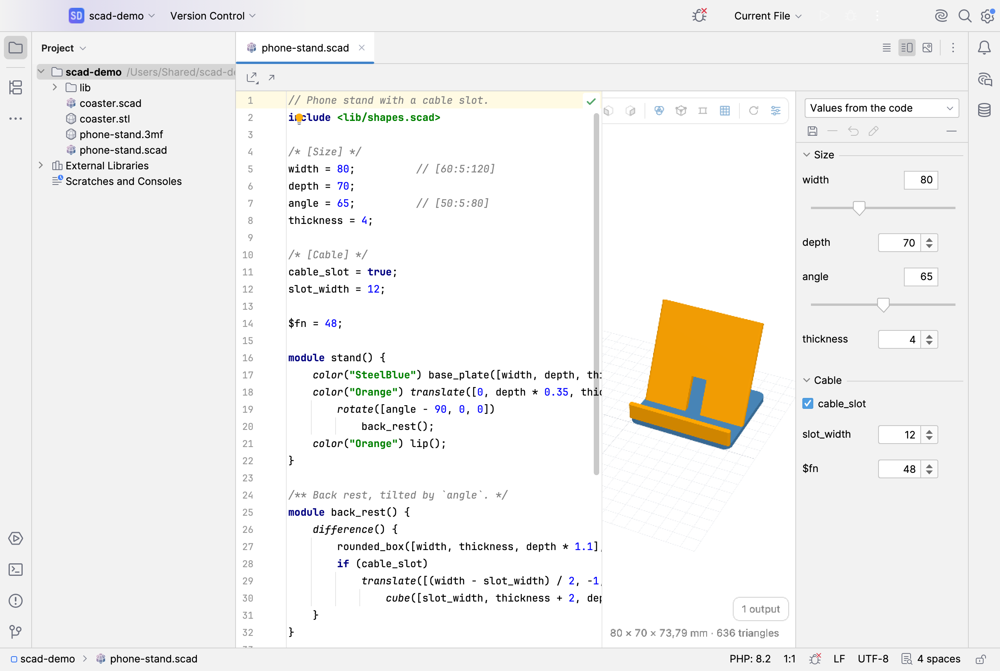

# SCAD Sphere


Plugin ID `app.heckit.ide.scadsphere` · Vendor heck\it ([heckit.app](https://heckit.app)) · Source: https://github.com/phse/scad-sphere · Support: [GitHub Sponsors](https://github.com/sponsors/phse) or [Ko-fi](https://ko-fi.com/phse_de) · Feedback and feature requests: [plugin-scad-sphere@heckit.app](mailto:plugin-scad-sphere@heckit.app)



A plugin for JetBrains IDEs (PhpStorm, IntelliJ IDEA, … 2026.1 and later) for [OpenSCAD](https://openscad.org):
language support for `.scad` files, a live 3D preview rendered with the installed OpenSCAD with a Customizer for the
parameters, export to all formats OpenSCAD writes, and a viewer and converter for `.stl`, `.3mf`, `.obj`, `.off` and
`.amf` files.

The language support only ever searches OpenSCAD files. Find Usages in PHP, HTML or any other language is not
slowed down by it: the plugin registers no global search extensions, its references reject non-OpenSCAD targets
before resolving anything, and the use scope of every declaration is limited to `.scad` files (or to the block,
loop or `let` it lives in).

**Editing**

- Highlighting: keywords, numbers, strings, `include`/`use` paths, comments, plus declarations, module and
  function calls (own and built-in), parameters, named arguments, special variables (`$fn`, `$fa`, …) and
  modifiers (`# ! % *`). Colors in *Settings | Editor | Color Scheme | OpenSCAD*.
- **Go to declaration**, **Find Usages**, **Rename** (in place) and highlighting of usages for modules,
  functions, variables and parameters. Named arguments (`cube(size = 3)`) point to the parameter, so renaming a
  parameter renames them too. Scopes follow OpenSCAD: blocks, module and function parameters, `for`/`let`
  variables (also in list comprehensions), the file, then `include` (everything, transitive) and `use` (modules
  and functions only).
- `include <…>`/`use <…>` paths are links (⌘-click), complete like file paths and follow file renames.
  They are looked up next to the file, in the folders from *Settings | Tools | SCAD Sphere*, in `OPENSCADPATH`,
  in the user library folder (`~/Documents/OpenSCAD/libraries` on macOS) and in the libraries of the installation.
- **Completion** of modules, functions, variables, the built-ins and, inside a call, the parameter names of the
  called module or function (`name = `). **Parameter info** (⌘P / Ctrl+P).
- **Documentation** (F1 / Ctrl+Q, also on hover): built-in modules and functions with signature, description
  and a link to the OpenSCAD manual; own modules, functions and variables with their signature and the comment
  above them (or after them on the same line, as for Customizer variables).
- Structure view, folding (blocks, comments, long vectors), comment/uncomment, brace matching, TODO comments.
- Indentation on Enter and **Reformat Code** (indentation only; spacing within lines stays as written).
  Indent size in *Settings | Editor | Code Style | OpenSCAD*.

**Preview**

- `.scad` files open as a split editor, like Markdown: code on the left, model on the right. The buttons at the
  top right switch between editor, both and preview.
- OpenSCAD renders in the background (`openscad -o model.3mf`) while you type (pause configurable), when the file
  is saved or only on request. Unsaved text goes through stdin with the file's folder as working directory, so
  `include`, `use` and `import()` find their relative paths. Files read by the last run (from OpenSCAD's
  dependency list) are watched: changing an included file renders again.
- Colors from `color()` are kept (3MF export with colors), 2D designs are shown flat on the grid (SVG export).
  The camera stays where it is when the model changes.
- Errors, warnings and `echo` output appear at the bottom right of the preview; a click on `file.scad:12` opens
  that line. On errors the last model stays visible.
- Editor toolbar: **Export with OpenSCAD ▸** and **Open in OpenSCAD** (also in the project tree and the editor tab
  menu). Render again (stop while rendering) and the Customizer button sit at the right end of the viewer toolbar.

**Customizer**

- A panel next to the preview with the parameters of the file, following OpenSCAD's rules: assignments with a fixed
  value (number, text, `true`/`false`, vector of up to 4 numbers) before the first line with `{`. Groups from
  `/* [Group] */` (collapsible, `[Hidden]` is left out), the description from the `//` line above the variable.
- The comment after the value chooses the field, as in OpenSCAD: `// [0:5:100]`, `// [min:max]` or `// [max]` for a
  slider, `// [a, b, c]` or `// [10:Small, 20:Large]` for a drop-down, `// 8` for the maximum length of a text;
  checkboxes for `true`/`false`, number fields otherwise.
- Changed values are not written into the file: the preview renders with `-D name=value`, changed names are shown
  in bold with a button to reset them. The values are remembered per file (in the workspace).
- Parameter sets in `<file>.json`, the format of the OpenSCAD GUI, so both see the same sets: choose, save as, delete.
  *Reset* goes back to the selected set or to the code, *Write Values to Code* puts the changed values into the file
  (one undoable step).
- Export uses the Customizer values. The panel is toggled with the slider button in the viewer toolbar or hidden with the button in the panel.

**Export**

- *Export with OpenSCAD ▸* lists the formats: 3MF, STL, OBJ, OFF, AMF for 3D models, SVG, DXF, PDF for 2D designs (only
  the fitting ones once the preview has rendered). A dialog asks for the file and, where the installed OpenSCAD
  supports them, for options: binary or ASCII STL, colors and unit of a 3MF, paper size and orientation of a PDF. The
  options are detected from `openscad --help` and `--help-export` and the last choice is remembered.
- *Export Again* (first entry, also bindable to a shortcut) exports to the last target without asking.

**Viewer** (`.stl` binary and ASCII, `.3mf`, `.obj`, `.off`, `.amf`; also used for the preview)

- Rotate with the left mouse button, pan with the right one, zoom with the wheel (towards the cursor).
- Views: fit, isometric, top, front, right. Colors (or everything in one color), edges, orthographic projection and
  the grid can be toggled.
- Size of the model in mm (bounding box) and the number of triangles at the bottom left.
- Files reload when they change on disk (e.g. after an export).
- **Convert To ▸** (toolbar above the model, project tree, also for several files): OpenSCAD imports the model and
  writes 3MF, STL, OBJ, OFF or AMF next to it. **New .scad File from Model** creates a file with `import("model.stl");`
  to scale, cut or extend a downloaded model.

**Settings** (*Settings | Tools | SCAD Sphere*): path to OpenSCAD (found automatically in the usual places of
macOS, Windows and Linux), additional library folders, when to render, pause before rendering, preview shown on
opening.

The UI is available in English and German.

## Installation

Not yet on the JetBrains Marketplace. Build the ZIP (see below) and install it via
*Settings | Plugins | ⚙ | Install Plugin from Disk…*. Other OpenSCAD plugins also claim `.scad` files; disable them
to avoid the file type conflict.

## Build and run

Gradle needs JDK 17 or later. The toolchain (JDK 25) is downloaded by Gradle via foojay if needed. The 3D viewer
in `web/` is built with npm (three.js, esbuild) as part of the Gradle build.

```
./gradlew runIde        # start a sandbox IDE with the plugin
./gradlew buildPlugin   # build/distributions/scad-sphere-<version>.zip
./gradlew test          # lexer, parser, resolve, rename, completion, formatter, Customizer and export tests (export tests need OpenSCAD)
```

Verify against the local IDE, the oldest supported version (`verifyOldestVersion`) and the newest EAP
(`verifyNewestVersion`):

```
./gradlew verifyPlugin
```

Options (`-P…`):

- `openProject=/path/to/project` opens a project in the sandbox right away
- `jcefDebugPort=9333` opens the DevTools port of the embedded browser (connect with Chrome or Playwright)
- `samples=<folder with .scad>` (with `test`) parses all files of a folder and lists syntax errors; BOSL2 and
  NopSCADlib parse without errors

By default Gradle downloads PhpStorm `platformVersion` (from `gradle.properties`) as the target platform. With an
installed IDE it's faster: create `local.properties` (not checked in) containing e.g.

```
platformLocalPath=/Applications/PhpStorm.app
```

## Publishing (JetBrains Marketplace)

The Marketplace description lives in `src/main/resources/META-INF/plugin.xml`, the change notes in
`build.gradle.kts`, the icon in `META-INF/pluginIcon.svg` (light theme) and `pluginIcon_dark.svg` (dark theme).
`marketplace/plugin-icon.png` at the top of this README is a preview of both.

1. Bump the version in `gradle.properties`, add change notes.
2. `./gradlew clean buildPlugin verifyPlugin` (fix any deprecated API it reports before releasing)
3. The first version is uploaded by hand on the Marketplace; after that `./gradlew publishPlugin` with a token
   (`PUBLISH_TOKEN` or `jetbrainsMarketplaceToken` in `~/.gradle/gradle.properties`). JetBrains reviews every version.
4. Tag the commit (`git tag v<version>`) and push.

## Regenerating the screenshots

```
./gradlew runIde -Pscreenshots=marketplace/screenshots
```

Copies `marketplace/demo-project` to `/Users/Shared/scad-demo` (so no user path shows up in the images), opens it in
the sandbox and writes the PNGs listed in `marketplace/screenshots.txt` (file, theme, layout, `nocustomizer`,
Customizer values as `set:name=value` per line). The IDE
paints its own window for this, no screen recording permission is needed. OpenSCAD must be installed for the
preview. The helper lives in `src/screenshot/` and is only compiled with `-Pscreenshots`, never into a release.
Close any running sandbox first, and close the sandbox afterwards. `-PscreenshotProject=<folder>` uses another
project with its own `screenshots.txt`.

## How it works

| File | Contents |
| --- | --- |
| `lang/ScadLanguage.kt` | Language and file types (`.scad`, `.stl`, `.3mf`); own IDs so other OpenSCAD plugins can be installed side by side |
| `lang/ScadLexer.kt` | Hand-written lexer; one state: after `include`/`use`, `<…>` is a path |
| `lang/ScadParser.kt` | Recursive descent parser after OpenSCAD's `parser.y`, with error recovery that never crosses a line break |
| `psi/ScadPsi.kt` | PSI elements: declarations, module calls, references, `include`/`use` |
| `psi/ScadResolver.kt` | Scopes and name resolution, use scopes for Find Usages |
| `psi/ScadImports.kt` | `include`/`use`: path lookup, library folders, imported declarations (cached until the next change) |
| `lang/ScadBuiltins.kt` | Built-in modules, functions and special variables with signatures and descriptions |
| `lang/ScadCompletion.kt`, `ScadDocumentation.kt`, `ScadParameterInfo.kt` | Completion, quick documentation, parameter info |
| `lang/ScadFormatting.kt` | Indentation-only formatter and code style settings |
| `render/OpenScad.kt`, `OpenScadRender.kt` | Finding OpenSCAD and what it can export, running it (stdin, working directory, `OPENSCADPATH`, `-D`, `-O`), messages, dependencies, export, conversion via `import()` |
| `customizer/ScadCustomizer.kt` | Customizer parameters after OpenSCAD's rules (tested against OpenSCAD's own `-o file.param`), values, `-D` arguments |
| `customizer/CustomizerPanel.kt`, `ParameterSets.kt` | The panel next to the preview; parameter sets in OpenSCAD's `<file>.json` |
| `export/ExportFormat.kt`, `ExportDialog.kt`, `ExportActions.kt` | Formats and their options, the export dialog, *Export ▸*, *Export Again*, *Convert To ▸*, *New .scad File from Model* |
| `ScadFileStates.kt` | Per file in the workspace: Customizer values, selected set, last export target |
| `viewer/ModelViewer.kt`, `ViewerResources.kt` | JCEF browser with the viewer, served from `https://scadsphere.ide/`; the model goes in as a file, commands as JavaScript |
| `editor/ScadPreviewEditor.kt` | Split editor and preview: when to render, keeping the camera, navigation from messages |
| `editor/ModelFileEditor.kt` | Viewer for `.stl`, `.3mf`, `.obj`, `.off`, `.amf` with the convert toolbar |
| `web/src/viewer.js` | three.js scene: loaders (STL, 3MF, OBJ, AMF, OpenSCAD's SVG), colors or monochrome, camera, grid, edges, toolbar, messages |
| `web/src/offLoader.js` | OFF with colors per face, as OpenSCAD writes it |

Since 2026.x JCEF renders off-screen and a non-passive `wheel` listener makes Chromium wait for the page on every
wheel event; `web/src/passiveWheel.js` registers all wheel listeners (including the one of OrbitControls) as passive.
The viewer only draws when something changes, there is no animation loop.

## License

Apache License 2.0, see [`LICENSE`](LICENSE) and [`NOTICE`](NOTICE).
Copyright 2026 Peter Heck (heck\it). The name and logo are not covered by the license.
three.js and fflate (MIT) are bundled; OpenSCAD is not bundled.
